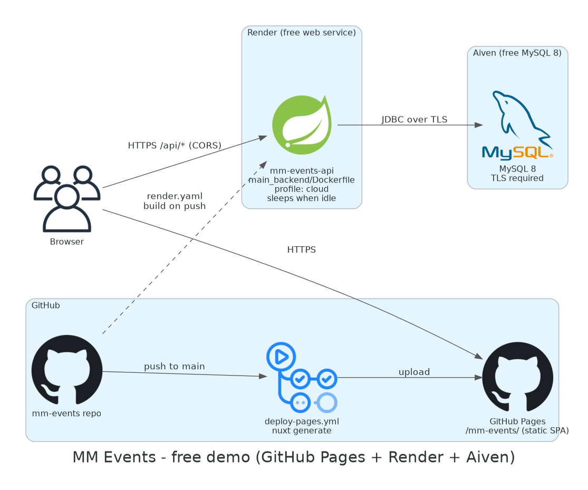

# MM Events – Concert Booking Platform

MM Events is a concert and event booking web application built as a team project
for **ITDS323 (DevOps)** at Mahidol University. Visitors browse upcoming concerts,
register and log in, book tickets and manage their bookings; organizers create,
edit and delete their own events with photos and a venue map.

The course focus was the delivery pipeline around the app: containerisation,
automated testing, CI/CD, Kubernetes and infrastructure as code on AWS.

> **Status:** the AWS infrastructure (EC2, RDS, ElastiCache, S3/CloudFront,
> Cognito, API Gateway, EKS) was used during the course and **has been
> decommissioned**; that AWS account is closed. The course's Terraform and
> Kubernetes code (`aws/`, `infra/terraform/`, `k8s/`) is kept as a record only.
> The demo setup now uses free tiers (GitHub Pages + Render + Aiven MySQL), and `deploy/` has new,
> deployable Terraform and a Helm chart for managed Kubernetes on AWS (EKS),
> Google Cloud (GKE) and Azure (AKS) (see [Infrastructure](#infrastructure)).
>
> This repository is a cleaned copy of the team repository
> [MorningMores/develop](https://github.com/MorningMores/develop). Commit history
> and authorship are preserved; credentials, Terraform state, keys and build
> artifacts were removed from all history.

## Infrastructure

### Current setup: free demo on GitHub Pages + Render + Aiven



| Part | Where it runs | Configured by |
|---|---|---|
| Frontend (static Nuxt SPA) | GitHub Pages, `https://putinun-te.github.io/mm-events/` | `.github/workflows/deploy-pages.yml` (`nuxt generate` on every merge to `main`) |
| Backend (Spring Boot API) | Render free web service built from `main_backend/Dockerfile` | `render.yaml`, `application-cloud.properties` |
| Database (MySQL 8) | Aiven free MySQL plan, TLS required | JDBC URL entered in Render |
| Secrets (DB password, JWT secret) | Render environment variables | entered once in the Render dashboard, never in the repository |
| CI | GitHub-hosted runners | `.github/workflows/` (see [CI/CD](#cicd)) |

All three are free plans without a time limit. The backend sleeps after ~15 idle minutes
and takes about a minute to wake. The site goes live after the one-time account setup in
[docs/DEPLOY.md](docs/DEPLOY.md), which also lists the limits.

### Deploying to Kubernetes on AWS, Google Cloud or Azure (`deploy/`)

Terraform per cloud for the network, managed Kubernetes cluster, container registry,
managed MySQL 8, secret store and workload identities, plus one Helm chart
([`deploy/helm/mm-events`](deploy/helm/mm-events)) that runs the backend (probes, HPA,
PodDisruptionBudget), the nginx frontend and an Ingress on all three, with secrets pulled
from the cloud's secret store by the External Secrets Operator. Each cloud has an
architecture diagram, a README (`terraform apply`, kubeconfig, pushing the images,
`helm install`, rough monthly cost, `destroy`) and a `terraform.tfvars.example`.
Overview and diagrams: [deploy/README.md](deploy/README.md).

| Cloud | Kubernetes | Ingress | Database | Secrets | Rough cost / month |
|---|---|---|---|---|---|
| [AWS](deploy/terraform/aws/README.md) | EKS + managed node group | ALB (AWS Load Balancer Controller) | RDS MySQL 8 | Secrets Manager + IRSA | ~USD 255 |
| [Google Cloud](deploy/terraform/gcp/README.md) | GKE Standard, zonal | GKE Ingress (external Application LB) | Cloud SQL MySQL 8 | Secret Manager + Workload Identity | ~USD 100 |
| [Azure](deploy/terraform/azure/README.md) | AKS, Free tier | Application Gateway for Containers | MySQL Flexible Server | Key Vault + Workload Identity | ~USD 225 |

These are checked in CI (`deploy-checks.yml`: `terraform fmt`/`validate`, `helm lint`,
`helm template | kubeconform`) and have not been applied from this repository:
`terraform apply` creates billable resources in your own account.

### Course infrastructure (shut down)

`aws/`, `infra/terraform/` and `k8s/` are the original infrastructure from the ITDS323
course (EC2, ECS Fargate, Lambda, API Gateway, Cognito, ElastiCache and EKS on AWS). The
account they ran in has been closed and none of those resources exist any more. The code
is kept as a record of the course work; use `deploy/terraform/` for a new deployment.

## Features

- Event catalogue with details, photos and an OpenStreetMap map of the venue (Leaflet, no API key)
- Registration and login with JWT (Spring Security)
- Create, edit and delete events; join/leave events
- Ticket bookings, booking cancellation and a "My bookings" page
- Profile and account settings with avatar upload (local disk or S3 presigned URLs)
- OpenAPI document and Swagger UI for the REST API
- Schema migrations with Flyway; logout that revokes the token; login rate limiting

## Tech stack

| Layer | Technologies |
|---|---|
| Frontend | Nuxt 4 (SPA), Vue 3, Tailwind CSS 4, Leaflet + OpenStreetMap |
| Backend | Java 21, Spring Boot 3.5 (Web, Data JPA, Security, Validation, Actuator, Data Redis, Mail), Flyway, springdoc-openapi, JJWT, AWS SDK v2 (S3) |
| Data | MySQL 8, Redis 7 |
| Testing | JUnit 5, Spring Boot Test, Testcontainers, JaCoCo; Vitest, Vue Test Utils, Testing Library; Cypress |
| Containers | Docker (multi-stage images), Docker Compose |
| Orchestration | Kubernetes on Amazon EKS (Deployment, Service, HPA), Prometheus, Grafana, Actions Runner Controller |
| Infrastructure | Terraform: VPC, EC2, RDS, ElastiCache, S3, CloudFront, Cognito, API Gateway, Lambda, ECS Fargate, CloudWatch |
| CI/CD | GitHub Actions, Dependabot, gitleaks |

## Architecture


## Repository layout

| Path | Contents |
|---|---|
| `main_backend/` | Spring Boot API (`src/main`), tests (`src/test`), Dockerfile |
| `main_frontend/concert1/` | Nuxt 4 app (`app/`), unit tests (`test/unit`), e2e tests (`test/e2e`), Cypress specs, Dockerfile + nginx config |
| `docker-compose.yml` | Local stack: MySQL, Redis, backend, frontend (and a `tests` profile for Dockerised backend tests) |
| `docker-compose.prod.yml` | Backend + frontend images against an external RDS database (reads `.env`) |
| `deploy/` | Deployable Terraform for EKS, GKE and AKS (`deploy/terraform/<cloud>/`), the shared Helm chart (`deploy/helm/mm-events/`) and the architecture diagrams with their sources (`deploy/diagrams/`) |
| `k8s/` | Course infrastructure, shut down: EKS manifests (backend Deployment/Service/HPA, Redis, Prometheus/Grafana, runner deployment) |
| `aws/` | Course infrastructure, shut down: Terraform for the EC2-based deployment (VPC, EC2, RDS, ElastiCache, S3, Cognito, API Gateway, CloudWatch, IAM), plus the Lambda sources and EC2 user data |
| `infra/terraform/` | Course infrastructure, shut down: Terraform for the serverless (`serverless/`, `production/`) and ECS Fargate (`ecs-fargate/`) variants |
| `.github/workflows/` | `backend-ci.yml` (backend tests + coverage gate), `ci.yml` (frontend, e2e, images, secret scan), `mutation-tests.yml`, `load-test.yml`, `deploy-pages.yml`, `deploy-checks.yml` (Terraform and Helm checks for `deploy/`) |
| `load-tests/` | k6 booking-rush script |
| `docs/` | Live demo setup (`DEPLOY.md`) and design notes comparing AWS hosting options; see [docs/README.md](docs/README.md) |

## Run locally

Requirements: Docker with Docker Compose v2.

```bash
docker compose up -d --build
```

| Service | URL |
|---|---|
| Frontend | http://localhost:3000 |
| Backend API | http://localhost:8080 |
| Health check | http://localhost:8080/actuator/health |
| API docs (Swagger UI) | http://localhost:8080/swagger-ui.html |
| OpenAPI document | http://localhost:8080/v3/api-docs |

The first start takes a few minutes: the backend image is built with Maven and
the frontend container runs `npm install`. No `.env` file is needed for local
use; all values in `docker-compose.yml` are local-only defaults. The venue map uses OpenStreetMap and needs no key.

In Swagger UI, log in with `POST /api/auth/login`, copy the `token` from the response and
paste it under **Authorize** to call the protected endpoints.

### Database schema (Flyway)

The schema is created by Flyway from `main_backend/src/main/resources/db/migration`
(`V1__baseline.sql`, `V2__...`). Hibernate only validates it (`ddl-auto=validate`), so a
mismatch between an entity and the tables stops startup instead of silently changing the
database. A database that Hibernate created before Flyway was added is adopted at version 1
and receives only the later migrations. To change the schema, add a new file
`V<next>__<description>.sql`; never edit a migration that has already run.

### Security settings

| Setting | Variable | Default |
|---|---|---|
| Origins allowed by CORS (comma-separated, patterns such as `http://localhost:[*]`) | `APP_CORS_ALLOWED_ORIGINS` | `http://localhost:[*],http://127.0.0.1:[*]` |
| Access token lifetime in ms | `JWT_EXPIRATION_MS` | `900000` (15 minutes) |
| Refresh token lifetime in days | `JWT_REFRESH_EXPIRATION_DAYS` | `14` |
| Signing key, at least 64 characters | `JWT_SECRET` | local profiles only; required in `prod` and `cloud` |

- Login and registration return a short-lived access token and a refresh token.
  `POST /api/auth/refresh` trades the refresh token for a new pair; the old refresh token
  stops working, and presenting it again ends the whole session (it was copied). Only a
  SHA-256 hash of each refresh token is stored. The frontend refreshes automatically when a
  request gets 401 and retries it once.
- `POST /api/auth/logout` revokes the access token (its id is stored until it expires) and,
  with `{"refreshToken": ...}` in the body, the refresh token's session.
- After 5 failed logins for the same account from the same address, further attempts get
  `429 Too Many Requests` with `Retry-After` for 15 minutes (in memory, per instance).
- Error responses do not include exception messages; details go to the backend log.
- The H2 console is not exposed, and responses carry `X-Frame-Options: DENY`,
  `X-Content-Type-Options: nosniff` and `Referrer-Policy: no-referrer`.

Stop everything and delete the database volume:

```bash
docker compose down -v
```

### Frontend without Docker

Start only the data stores and the API in Docker, then run Nuxt with hot reload:

```bash
docker compose up -d --build mysql redis backend
cd main_frontend/concert1
npm ci --legacy-peer-deps
npm run dev
```

## Testing

### Backend (`main_backend/`)

Tests are split in two Maven phases, exactly as CI runs them:

| Kind | What runs | Command | Needs |
|---|---|---|---|
| Unit | Plain JUnit/Mockito tests and Spring slices (`@WebMvcTest` with the real security config, `@DataJpaTest` on H2) — surefire | `./mvnw -B -ntp test` | JDK 21 |
| Integration | Full Spring context and Testcontainers tests on MySQL 8.0 (`*IT`, `integration/**`, `*DockerTest`), then the coverage gate — failsafe | `./mvnw -B -ntp verify -DskipUTs=true` | JDK 21 + Docker |
| Both | Unit, integration and the coverage gate in one go | `./mvnw -B -ntp verify` | JDK 21 + Docker |

`main_backend/run-tests.sh` wraps the same commands:

```bash
cd main_backend
./run-tests.sh            # unit, then integration + coverage gate (same as CI)
./run-tests.sh unit       # unit tests only, no Docker
./run-tests.sh coverage   # same as CI, then prints a coverage summary
./run-tests.sh specific EventServicePhotoTest
```

No local JDK? `main_backend/run-docker-tests.sh` runs the same commands inside
a Maven container (Docker Compose profile `tests`).

New integration tests go in a class whose name ends in `IT`; everything else
runs as a unit test. S3 is always a Mockito fake in tests, and nothing needs
AWS credentials.

### Coverage report

JaCoCo writes two HTML reports:

- `main_backend/target/site/jacoco/index.html` – unit + integration, the one the gate checks
- `main_backend/target/site/jacoco-unit/index.html` – unit tests only (after `./mvnw test`)

Open `index.html` and drill down package → class → source: green lines are
covered, red are not, yellow lines have branches that were only partly taken.

The gate (`jacoco.minLine` / `jacoco.minBranch` in `main_backend/pom.xml`) fails
`mvn verify` when total line or branch coverage drops below the minimum. It is
set one point below the measured coverage (currently 94% lines, 83% branches); raise it when you add tests, never
lower it to make a build pass.

### Frontend and end-to-end

| What | Command | Notes |
|---|---|---|
| Frontend unit | `cd main_frontend/concert1 && npm run test` | `npm run test:coverage` for coverage. As in Nuxt, `~/` means `app/`, so tests import and mock the same files the app uses |
| API end-to-end | `docker compose up -d --build --wait`, then `cd main_frontend/concert1 && npm run test:e2e` | Runs against the local stack on :3000 / :8080 |
| Cypress UI tests | `cd main_frontend/concert1 && npm run test:cy:headless` | Needs the local stack running; sign-up, login, browsing, booking, cancelling and the "sold out" case. Each test creates its own users and events through the API |

### Mutation testing (backend)

[PIT](https://pitest.org) changes the business logic in small ways (flips a condition,
removes a call, changes a return value) and checks that a unit test fails for each
change. A surviving mutant is a bug the tests would not notice.

```bash
cd main_backend
./mvnw -Pmutation test-compile org.pitest:pitest-maven:mutationCoverage
open target/pit-reports/index.html
```

Scope: services, security, error mapping and utilities. Current score 99% (239 of 242;
the three survivors are equivalent mutants). The build fails below 97%
(`pit.mutationThreshold` in the `mutation` profile).

### Load testing

`load-tests/booking-rush.js` is a [k6](https://k6.io) "ticket rush": many buyers book the
same limited event at the same moment while others browse the event list. It fails on
unexpected responses, on overbooking, or when p95 latency goes over 500 ms (browsing) or
3 s (booking).

```bash
docker compose up -d --build --wait mysql redis backend
docker run --rm -i -e BASE_URL=http://host.docker.internal:8080 grafana/k6:2.3.0 run - < load-tests/booking-rush.js
```

`SEATS` and `BUYERS` (default 50 and 120) change the size of the rush. Local result: 120
buyers for 50 seats, exactly 50 sold and 70 told "sold out", booking p95 about 250 ms.

## CI/CD

All workflows run on GitHub-hosted runners only: no self-hosted runners, no
cloud credentials, no deploy jobs.

**`backend-ci.yml`** (push to `main`, every pull request):

1. **changes** – checks whether `main_backend/**` (or the workflow) changed.
2. **tests** – only when the backend changed: Temurin 21 with the Maven cache,
   `./mvnw test` (unit), then `./mvnw verify -DskipUTs=true` (integration on
   Testcontainers MySQL 8.0 + coverage gate). Uploads the surefire, failsafe
   and JaCoCo reports as the `backend-test-reports` artifact and writes a
   test and coverage table to the run's summary page.
3. **backend-ci** – always runs and reports the result, so it can be a required
   status check even on pull requests that do not touch the backend.

**`ci.yml`** (push to `main`, every pull request):

1. **frontend** – `npm ci`, Vitest unit tests, `nuxt build`
2. **e2e** – starts the Docker Compose stack and runs the API e2e suite and the Cypress UI tests
3. **docker-images** – builds the backend and frontend images (not pushed)
4. **secret-scan** – gitleaks over the full git history (`.gitleaks.toml`)

**`mutation-tests.yml`** runs PIT on backend pull requests (not a required check), weekly
and on demand. **`load-test.yml`** runs the k6 ticket rush on demand and weekly.
**`deploy-pages.yml`** publishes the frontend to GitHub Pages (see `docs/DEPLOY.md`).
**`deploy-checks.yml`** runs `terraform fmt -check` and `terraform validate` on the modules
in `deploy/terraform/`, and `helm lint` plus `helm template | kubeconform -strict` on the
chart for each cloud (no cloud credentials).

To see why a backend run failed, open the run in the Actions tab: the summary
page lists failed tests and coverage per package, and the
`backend-test-reports` artifact has the full reports.

During the course the pipeline also pushed images to GHCR and deployed to EKS
through self-hosted runners; those jobs needed AWS credentials and were removed
together with the infrastructure. Their history is in the git log and under
the `archive/*` tags.

## Deploying again (optional)

For the free demo (GitHub Pages + Render + Aiven) follow [docs/DEPLOY.md](docs/DEPLOY.md).
For Kubernetes on AWS, Google Cloud or Azure use the Terraform and Helm chart in
[deploy/](deploy/README.md).

The options below recreate the original course setup from the shut-down infrastructure
code. They are kept for reference and create billable AWS resources in **your** account.

- **Terraform:** `cd aws` (or `infra/terraform/<variant>`), copy
  `terraform.tfvars.example` to `terraform.tfvars`, fill in your values, then
  `terraform init && terraform plan && terraform apply`. State and `*.tfvars`
  files are git-ignored.
- **Kubernetes:** replace the placeholder values in the `backend-secrets` Secret
  inside `k8s/backend-deployment.yaml` (or create the Secret with `kubectl create
  secret`), set your image, then `kubectl apply -f k8s/`.
- **Docker Compose on a VM:** copy `.env.example` to `.env`, fill in the
  production section and run `docker compose -f docker-compose.prod.yml up -d --build`.

## Branches and tags

`main` holds the final state of the project. The `archive/*` tags keep earlier
lines of work (test branches, the Kubernetes and AWS experiments and individual
frontend branches) so that every team member's commits remain in the history.
Browse one with `git log archive/k8s-development` or check it out in a separate
worktree with `git worktree add ../k8s archive/k8s-development`.

## My role

**Fullstack Developer and Tester** – Putinun ([@Putinun-te](https://github.com/Putinun-te)).
I worked on both the Spring Boot backend and the Nuxt frontend, and wrote and
maintained the backend and frontend test suites (JUnit with Testcontainers,
Vitest, API end-to-end tests). I also contributed to the project's Docker,
CI/CD, Kubernetes and Terraform setup.

## Credits

MM Events was built by the ITDS323 project team. The original repository, with
the full team and contributor history, is
[MorningMores/develop](https://github.com/MorningMores/develop).

## License

[MIT](LICENSE) – Copyright (c) 2025 PANAIYAKORN, PORAMEE, THANASON, PICHITCHAI,
PUTINUN, SUVEEWAT, KANTANAT.
