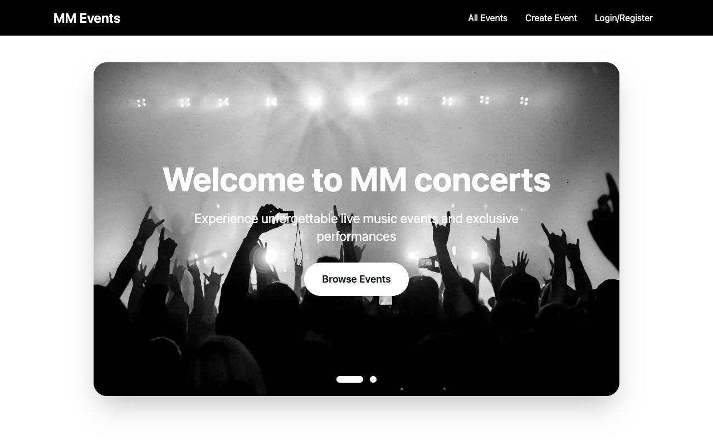
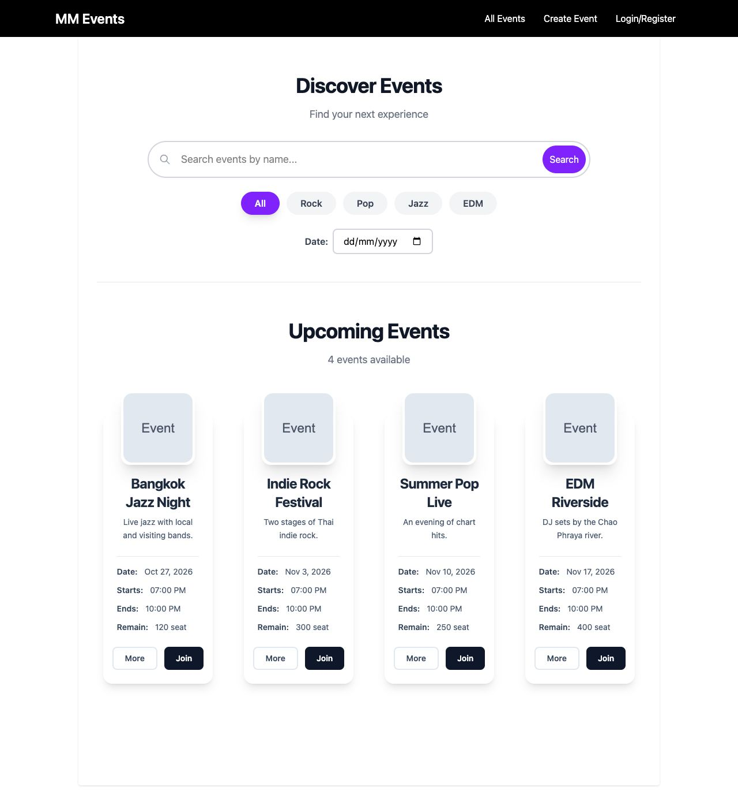
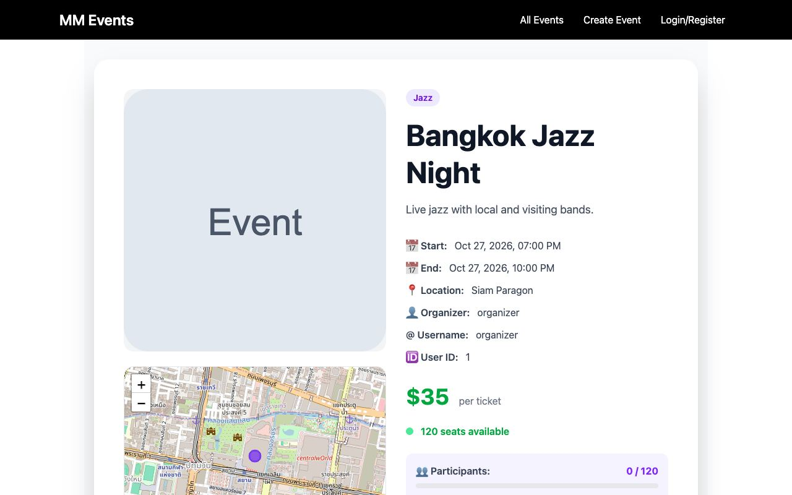
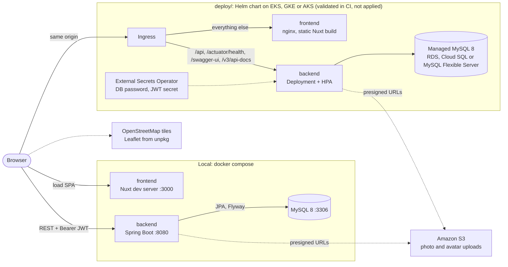

# MM Events – Concert Booking Platform

[](https://github.com/Putinun-te/mm-events/actions/workflows/ci.yml)
[](https://github.com/Putinun-te/mm-events/actions/workflows/backend-ci.yml)

MM Events is a concert and event booking web application. Visitors browse upcoming
concerts, register, log in, book tickets and cancel bookings; organizers create, edit and
delete their own events with photos and a venue map. It was built as a team project for the
**ITDS323 (DevOps)** course, so the emphasis is on the delivery pipeline around the app:
containers, layered automated tests, CI/CD, Kubernetes and infrastructure as code.

<p>
  
  
  
</p>

> This repository is a cleaned copy of the team repository
> [MorningMores/develop](https://github.com/MorningMores/develop). Commit history and
> authorship are preserved; credentials, Terraform state, keys and build artifacts were
> removed from all history. There is no hosted demo: run it locally (see
> [Getting started](#getting-started)).

## Tech stack

| Area | Technologies |
|---|---|
| **Frontend** | Nuxt 4 (client-side SPA, static build), Vue 3, Tailwind CSS 4, Leaflet + OpenStreetMap (no API key) |
| **Backend** | Java 21, Spring Boot 3.5 (Web, Data JPA, Security, Validation, Actuator), JJWT (HS512), BCrypt, Flyway, springdoc-openapi (Swagger UI), AWS SDK v2 for S3 uploads, Maven |
| **Data** | MySQL 8 (Flyway migrations; Hibernate only validates the schema) |
| **Testing** | JUnit 5, Mockito, Spring Boot Test, Testcontainers, JaCoCo, PIT mutation testing; Vitest, Vue Test Utils, Testing Library; Cypress; k6 |
| **Infrastructure** | Docker (multi-stage images) and Docker Compose; Kubernetes via one Helm chart (Deployment, HPA, PodDisruptionBudget, Ingress, External Secrets Operator); Terraform for EKS (AWS), GKE (Google Cloud) and AKS (Azure) |
| **CI/CD** | GitHub Actions, Dependabot, gitleaks, kubeconform |

## Architecture



The browser runs the SPA and calls the REST API directly. Compose also starts a Redis 7
container, but the application code does not use Redis.

Key design decisions visible in the code:

- **No overbooking under concurrency.** `BookingService.createBooking` takes a pessimistic
  write lock on the event row (`EventRepository.findByIdForUpdate`) and runs at
  `READ_COMMITTED`, so the seat count sees bookings committed while it waited for the lock.
  `BookingConcurrencyIT` and the k6 "ticket rush" test this.
- **Short-lived JWT plus rotating refresh tokens.** Access tokens last 15 minutes and carry
  a `jti`, so logout can revoke one. Refresh tokens last 14 days, are stored only as a
  SHA-256 hash, and are single use: presenting an old one ends the whole session. Login is
  rate limited (5 failures, then `429` with `Retry-After`). The frontend refreshes once on
  `401` and shares one refresh between concurrent requests.
- **Schema as code.** Flyway owns the schema (`db/migration/V1`–`V4`) and Hibernate runs with
  `ddl-auto=validate`, so an entity/table mismatch stops startup. A database that Hibernate
  created before Flyway is adopted at version 1; `FlywayMigrationIT` checks both paths on real
  MySQL.
- **One chart, three clouds.** The static Nuxt build is served by nginx behind the same
  Ingress as the API (one origin, no CORS), so the same Helm chart runs on EKS, GKE and AKS
  with small per-cloud values files. Passwords and the JWT secret are created through
  ephemeral resources and write-only arguments (on AWS, RDS generates the database
  password), so they are not stored in Terraform state or in git.
- **Quality gates, not just tests.** `mvn verify` fails below 94% line / 83% branch coverage
  (JaCoCo) and the PIT profile fails below a 97% mutation score; the secret scan runs over
  the full git history in CI.

## Getting started

**Prerequisites:** Docker with Docker Compose v2. For running outside Docker you also need
JDK 21 (Maven wrapper included) and Node 22.

```bash
docker compose up -d --build
```

The first start takes a few minutes (Maven build, then `npm install` in the frontend
container). No `.env` file is needed: `docker-compose.yml` contains local-only defaults.

| Service | URL |
|---|---|
| Frontend | http://localhost:3000 |
| Backend API | http://localhost:8080 |
| Health check | http://localhost:8080/actuator/health |
| Swagger UI | http://localhost:8080/swagger-ui.html |
| OpenAPI document | http://localhost:8080/v3/api-docs |

In Swagger UI, call `POST /api/auth/login`, copy the `token` from the response and paste it
under **Authorize** to try the protected endpoints. Stop everything and delete the database
volume with `docker compose down -v`.

To work on the frontend with hot reload, run only the API and database in Docker:

```bash
docker compose up -d --build mysql backend
cd main_frontend/concert1
npm ci --legacy-peer-deps
npm run dev
```

Backend settings that matter outside local use (all environment variables):

| Variable | Meaning | Default |
|---|---|---|
| `JWT_SECRET` | HS512 signing key, at least 64 characters | local dev value; **required** in the `prod` and `cloud` profiles |
| `JWT_EXPIRATION_MS` | Access token lifetime | `900000` (15 min) |
| `JWT_REFRESH_EXPIRATION_DAYS` | Refresh token lifetime | `14` |
| `APP_CORS_ALLOWED_ORIGINS` | Allowed browser origins, comma separated, patterns like `http://localhost:[*]` | localhost on any port |
| `SPRING_DATASOURCE_URL`, `_USERNAME`, `_PASSWORD` | MySQL connection | local MySQL |
| `SPRING_PROFILES_ACTIVE` | `docker` (Compose), `prod`, `cloud` (Helm chart), `dev` | – |

`.env.example` shows the variable names for a non-local setup (placeholders only).

## Testing

| Kind | Command | Needs |
|---|---|---|
| Backend unit (JUnit/Mockito, `@WebMvcTest` with the real security config, `@DataJpaTest` on H2) | `cd main_backend && ./mvnw -B -ntp test` | JDK 21 |
| Backend integration (full Spring context and Testcontainers on MySQL 8.0, `*IT` classes, then the JaCoCo gate) | `cd main_backend && ./mvnw -B -ntp verify -DskipUTs=true` | JDK 21, Docker |
| Backend, everything | `cd main_backend && ./run-tests.sh` (also `unit`, `coverage`, `specific <TestClass>`) | JDK 21, Docker |
| Backend in a container (no local JDK) | `cd main_backend && ./run-docker-tests.sh` | Docker |
| Frontend unit (Vitest: components, composables, pages) | `cd main_frontend/concert1 && npm run test` | Node 22 |
| API end-to-end (Vitest against the running stack) | `docker compose up -d --build --wait`, then `cd main_frontend/concert1 && npm run test:e2e` | Docker, Node 22 |
| UI end-to-end (Cypress: sign-up, login, browsing, booking, cancelling, sold-out case) | stack running, then `cd main_frontend/concert1 && npm run test:cy:headless` | Docker, Node 22 |
| Mutation testing (PIT on services, security and error mapping) | `cd main_backend && ./mvnw -Pmutation test-compile org.pitest:pitest-maven:mutationCoverage` | JDK 21 |
| Load test (k6 "ticket rush": many buyers, limited seats) | `docker compose up -d --build --wait mysql redis backend`, then run `load-tests/booking-rush.js` with `grafana/k6` as in the CI workflow `load-test.yml` | Docker |

- Coverage reports: `main_backend/target/site/jacoco/index.html` (unit + integration; this
  is the one the gate checks) and `main_backend/target/site/jacoco-unit/index.html`.
  The gate thresholds are `jacoco.minLine` and `jacoco.minBranch` in `main_backend/pom.xml`.
- The k6 script fails on unexpected responses, overbooking, or p95 latency above 500 ms
  (browsing) or 3 s (booking). `SEATS` and `BUYERS` set the size of the rush.
- S3 is a Mockito fake in the tests; nothing needs AWS credentials.

## Deployment and CI/CD

All workflows run on GitHub-hosted runners with no cloud credentials and no deploy jobs.

| Workflow | Trigger | What it does |
|---|---|---|
| `backend-ci.yml` | push to `main`, pull requests | Detects whether `main_backend/**` changed; if so runs unit tests, then integration tests on Testcontainers MySQL and the coverage gate; uploads reports and writes a summary. A final always-run job `backend-ci` can serve as a required check. |
| `ci.yml` | push to `main`, pull requests | Frontend: `npm ci`, Vitest, `nuxt build`. End-to-end: starts the Compose stack, runs the API e2e suite and Cypress. Builds the backend and frontend Docker images (not pushed). Runs gitleaks over the full history. |
| `deploy-checks.yml` | changes under `deploy/` | `terraform fmt -check` and `terraform validate` for the AWS, GCP and Azure modules; `helm lint --strict` and `helm template \| kubeconform -strict` per cloud. |
| `mutation-tests.yml` | backend pull requests, weekly, manual | PIT mutation tests; fails below the gate in `pom.xml`. |
| `load-test.yml` | weekly, manual | k6 ticket rush against the Compose backend. |

Dependabot updates npm, Maven and GitHub Actions dependencies monthly.

**Deploying.** [`deploy/`](deploy/README.md) contains Terraform for a managed Kubernetes
cluster, registry, managed MySQL 8, secret store and workload identities on
[AWS](deploy/terraform/aws/README.md), [Google Cloud](deploy/terraform/gcp/README.md) and
[Azure](deploy/terraform/azure/README.md), plus the Helm chart
[`deploy/helm/mm-events`](deploy/helm/mm-events). These are validated by the checks above
but have not been applied from this repository: `terraform apply` creates billable resources
in your own account, and each cloud README lists a rough monthly cost.

**Earlier course infrastructure.** `aws/`, `infra/terraform/` and `k8s/` are the original
ITDS323 setup (EC2, ECS Fargate, Lambda, API Gateway, Cognito, ElastiCache and EKS). The AWS
account they ran in is closed, so they are kept as a record only. The course pipeline also
pushed images and deployed to EKS from self-hosted runners; those jobs were removed with the
infrastructure and remain in the git history and the `archive/*` tags.

## Project context

- **Course:** ITDS323 (DevOps), team project at ICT, Mahidol University; the commit
  history spans September 2025 onward and the license is dated 2025.
- **Team:** built by the ITDS323 project team; the full contributor history is in the
  original repository, [MorningMores/develop](https://github.com/MorningMores/develop).
- **Repository layout:** `main_backend/` (Spring Boot API and its tests),
  `main_frontend/concert1/` (Nuxt app, unit, e2e and Cypress tests), `deploy/` (Terraform and
  Helm), `load-tests/` (k6), `docs/` (AWS design notes from the course), and the three
  course-era directories above. The `archive/*` tags keep earlier lines of work, for example
  `git log archive/k8s-development`.

### My role

<!-- TODO(author): describe your role and the parts you built, in your own words. -->
_To be filled in._

## License

[MIT](LICENSE) – Copyright (c) 2025 PANAIYAKORN, PORAMEE, THANASON, PICHITCHAI, PUTINUN,
SUVEEWAT, KANTANAT.
