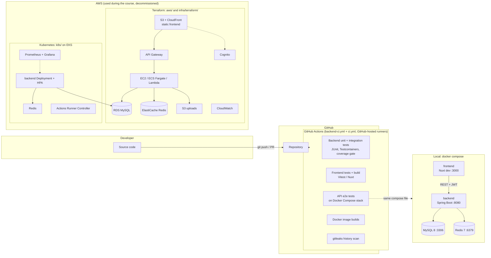

# MM Events – Concert Booking Platform

MM Events is a concert and event booking web application built as a team project
for **ITDS323 (DevOps)** at Mahidol University. Visitors browse upcoming concerts,
register and log in, book tickets and manage their bookings; organizers create,
edit and delete their own events with photos and a venue map.

The course focus was the delivery pipeline around the app: containerisation,
automated testing, CI/CD, Kubernetes and infrastructure as code on AWS.

> **Status:** the AWS infrastructure (EC2, RDS, ElastiCache, S3/CloudFront,
> Cognito, API Gateway, EKS) was used during the course and **has been
> decommissioned**. The Terraform and Kubernetes code is kept for reference and
> can be redeployed to your own account; nothing in this repository points at
> live resources.
>
> This repository is a cleaned copy of the team repository
> [MorningMores/develop](https://github.com/MorningMores/develop). Commit history
> and authorship are preserved; credentials, Terraform state, keys and build
> artifacts were removed from all history.

## Live demo

The demo setup is ready in the repository: frontend on GitHub Pages
(`https://putinun-te.github.io/mm-events/`), backend and MySQL on Railway. It goes live
after the one-time account setup in [docs/DEPLOY.md](docs/DEPLOY.md).

## Features

- Event catalogue with details, photos and an OpenStreetMap map of the venue (Leaflet, no API key)
- Registration and login with JWT (Spring Security); optional AWS Cognito sign-in
- Create, edit and delete events; join/leave events
- Ticket bookings, booking cancellation and a "My bookings" page
- Profile and account settings with avatar upload (local disk or S3 presigned URLs)

## Tech stack

| Layer | Technologies |
|---|---|
| Frontend | Nuxt 4 (SPA), Vue 3, Tailwind CSS 4, Axios, AWS Amplify (Cognito), Leaflet + OpenStreetMap |
| Backend | Java 21, Spring Boot 3.5 (Web, Data JPA, Security, Validation, Actuator, Data Redis, Mail), JJWT, AWS SDK v2 (S3) |
| Data | MySQL 8, Redis 7 |
| Testing | JUnit 5, Spring Boot Test, Testcontainers, JaCoCo; Vitest, Vue Test Utils, Testing Library; Cypress |
| Containers | Docker (multi-stage images), Docker Compose |
| Orchestration | Kubernetes on Amazon EKS (Deployment, Service, HPA), Prometheus, Grafana, Actions Runner Controller |
| Infrastructure | Terraform: VPC, EC2, RDS, ElastiCache, S3, CloudFront, Cognito, API Gateway, Lambda, ECS Fargate, CloudWatch |
| CI/CD | GitHub Actions, Dependabot, gitleaks |

## Architecture



## Repository layout

| Path | Contents |
|---|---|
| `main_backend/` | Spring Boot API (`src/main`), tests (`src/test`), Dockerfile |
| `main_frontend/concert1/` | Nuxt 4 app (`app/`), unit tests (`test/unit`), e2e tests (`test/e2e`), Cypress specs, Dockerfile + nginx config |
| `docker-compose.yml` | Local stack: MySQL, Redis, backend, frontend (and a `tests` profile for Dockerised backend tests) |
| `docker-compose.prod.yml` | Backend + frontend images against an external RDS database (reads `.env`) |
| `k8s/` | EKS manifests: backend Deployment/Service/HPA, Redis, Prometheus/Grafana, runner deployment |
| `aws/` | Terraform for the EC2-based deployment (VPC, EC2, RDS, ElastiCache, S3, Cognito, API Gateway, CloudWatch, IAM) |
| `infra/terraform/` | Terraform for the serverless (`serverless/`, `production/`) and ECS Fargate (`ecs-fargate/`) variants |
| `.github/workflows/` | `backend-ci.yml` (backend tests + coverage gate) and `ci.yml` (frontend, e2e, images, secret scan) |
| `scripts/` | Optional helpers for a self-hosted runner on EC2 |
| `docs/` | Design notes, testing guides and course write-ups; `docs/archive/` holds old deployment notes |

## Run locally

Requirements: Docker with Docker Compose v2.

```bash
docker compose up -d --build
```

| Service | URL |
|---|---|
| Frontend | http://localhost:3000 |
| Backend API | http://localhost:8080 |
| Health check | http://localhost:8080/actuator/health |

The first start takes a few minutes: the backend image is built with Maven and
the frontend container runs `npm install`. No `.env` file is needed for local
use; all values in `docker-compose.yml` are local-only defaults. The venue map uses OpenStreetMap and needs no key.

Stop everything and delete the database volume:

```bash
docker compose down -v
```

### Frontend without Docker

Start only the data stores and the API in Docker, then run Nuxt with hot reload:

```bash
docker compose up -d --build mysql redis backend
cd main_frontend/concert1
npm ci --legacy-peer-deps
npm run dev
```

## Testing

### Backend (`main_backend/`)

Tests are split in two Maven phases, exactly as CI runs them:

| Kind | What runs | Command | Needs |
|---|---|---|---|
| Unit | Plain JUnit/Mockito tests and Spring slices (`@WebMvcTest` with the real security config, `@DataJpaTest` on H2) — surefire | `./mvnw -B -ntp test` | JDK 21 |
| Integration | Full Spring context and Testcontainers tests on MySQL 8.0 (`*IT`, `integration/**`, `*DockerTest`), then the coverage gate — failsafe | `./mvnw -B -ntp verify -DskipUTs=true` | JDK 21 + Docker |
| Both | Unit, integration and the coverage gate in one go | `./mvnw -B -ntp verify` | JDK 21 + Docker |

`main_backend/run-tests.sh` wraps the same commands:

```bash
cd main_backend
./run-tests.sh            # unit, then integration + coverage gate (same as CI)
./run-tests.sh unit       # unit tests only, no Docker
./run-tests.sh coverage   # same as CI, then prints a coverage summary
./run-tests.sh specific EventServicePhotoTest
```

No local JDK? `main_backend/run-docker-tests.sh` runs the same commands inside
a Maven container (Docker Compose profile `tests`).

New integration tests go in a class whose name ends in `IT`; everything else
runs as a unit test. S3 is always a Mockito fake in tests, and nothing needs
AWS credentials.

### Coverage report

JaCoCo writes two HTML reports:

- `main_backend/target/site/jacoco/index.html` – unit + integration, the one the gate checks
- `main_backend/target/site/jacoco-unit/index.html` – unit tests only (after `./mvnw test`)

Open `index.html` and drill down package → class → source: green lines are
covered, red are not, yellow lines have branches that were only partly taken.

The gate (`jacoco.minLine` / `jacoco.minBranch` in `main_backend/pom.xml`) fails
`mvn verify` when total line or branch coverage drops below the minimum. It is
set one point below the measured coverage (currently 94% lines, 83% branches); raise it when you add tests, never
lower it to make a build pass.

### Frontend and end-to-end

| What | Command | Notes |
|---|---|---|
| Frontend unit | `cd main_frontend/concert1 && npm run test` | `npm run test:coverage` for coverage |
| API end-to-end | `docker compose up -d --build --wait`, then `cd main_frontend/concert1 && npm run test:e2e` | Runs against the local stack on :3000 / :8080 |
| Cypress UI tests | `cd main_frontend/concert1 && npm run test:cy:headless` | Needs the local stack running |

## CI/CD

All workflows run on GitHub-hosted runners only: no self-hosted runners, no
cloud credentials, no deploy jobs.

**`backend-ci.yml`** (push to `main`, every pull request):

1. **changes** – checks whether `main_backend/**` (or the workflow) changed.
2. **tests** – only when the backend changed: Temurin 21 with the Maven cache,
   `./mvnw test` (unit), then `./mvnw verify -DskipUTs=true` (integration on
   Testcontainers MySQL 8.0 + coverage gate). Uploads the surefire, failsafe
   and JaCoCo reports as the `backend-test-reports` artifact and writes a
   test and coverage table to the run's summary page.
3. **backend-ci** – always runs and reports the result, so it can be a required
   status check even on pull requests that do not touch the backend.

**`ci.yml`** (push to `main`, every pull request):

1. **frontend** – `npm ci`, Vitest unit tests, `nuxt build`
2. **e2e** – starts the Docker Compose stack and runs the API e2e suite
3. **docker-images** – builds the backend and frontend images (not pushed)
4. **secret-scan** – gitleaks over the full git history (`.gitleaks.toml`)

To see why a backend run failed, open the run in the Actions tab: the summary
page lists failed tests and coverage per package, and the
`backend-test-reports` artifact has the full reports.

During the course the pipeline also pushed images to GHCR and deployed to EKS
through self-hosted runners; those jobs needed AWS credentials and were removed
together with the infrastructure. Their history is in the git log and under
the `archive/*` tags.

## Deploying again (optional)

For the free-standing demo (GitHub Pages + Railway) follow [docs/DEPLOY.md](docs/DEPLOY.md).
The options below recreate the original AWS setup.

Everything below creates billable AWS resources in **your** account.

- **Terraform:** `cd aws` (or `infra/terraform/<variant>`), copy
  `terraform.tfvars.example` to `terraform.tfvars`, fill in your values, then
  `terraform init && terraform plan && terraform apply`. State and `*.tfvars`
  files are git-ignored.
- **Kubernetes:** replace the placeholder values in the `backend-secrets` Secret
  inside `k8s/backend-deployment.yaml` (or create the Secret with `kubectl create
  secret`), set your image, then `kubectl apply -f k8s/`.
- **Docker Compose on a VM:** copy `.env.example` to `.env`, fill in the
  production section and run `docker compose -f docker-compose.prod.yml up -d --build`.

## Branches and tags

`main` holds the final state of the project. The `archive/*` tags keep earlier
lines of work (test branches, the Kubernetes and AWS experiments and individual
frontend branches) so that every team member's commits remain in the history.
Browse one with `git log archive/k8s-development` or check it out in a separate
worktree with `git worktree add ../k8s archive/k8s-development`.

## My role

**Fullstack Developer and Tester** – Putinun ([@Putinun-te](https://github.com/Putinun-te)).
I worked on both the Spring Boot backend and the Nuxt frontend, and wrote and
maintained the backend and frontend test suites (JUnit with Testcontainers,
Vitest, API end-to-end tests). I also contributed to the project's Docker,
CI/CD, Kubernetes and Terraform setup.

## Credits

MM Events was built by the ITDS323 project team. The original repository, with
the full team and contributor history, is
[MorningMores/develop](https://github.com/MorningMores/develop).

## License

[MIT](LICENSE) – Copyright (c) 2025 PANAIYAKORN, PORAMEE, THANASON, PICHITCHAI,
PUTINUN, SUVEEWAT, KANTANAT.
