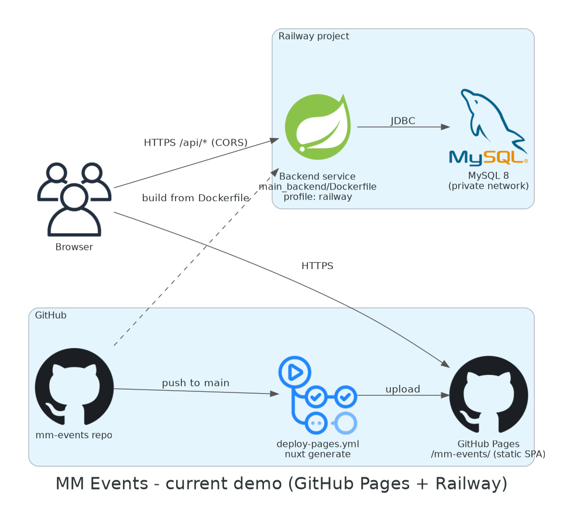

# Deploying MM Events

Four ways to run the app outside your laptop. They all use the same backend image
(`main_backend/Dockerfile`) and the same static frontend build (`npx nuxt generate` in
`main_frontend/concert1/`); only the hosting differs.

| Target | Backend | Database | Secrets | Frontend | Rough cost / month | Guide |
|---|---|---|---|---|---|---|
| **Current demo** | Railway | Railway MySQL | Railway variables | GitHub Pages | Railway plan (Pages is free) | [docs/DEPLOY.md](../docs/DEPLOY.md) |
| AWS | ECS Fargate + ALB | RDS MySQL 8 | Secrets Manager | S3 + CloudFront | ~USD 80 | [terraform/aws](terraform/aws/README.md) |
| Google Cloud | Cloud Run | Cloud SQL MySQL 8 | Secret Manager | Cloud Storage + LB + Cloud CDN | ~USD 30-35 | [terraform/gcp](terraform/gcp/README.md) |
| Azure | Container Apps | MySQL Flexible Server 8.0 | Key Vault | Static Web Apps | ~USD 25-30 | [terraform/azure](terraform/azure/README.md) |

The Terraform modules have been checked with `terraform fmt` and `terraform validate` only.
They have **not** been applied to a real account by this repository: every
`terraform apply` creates billable resources in the account you are logged in to.

## Current demo: GitHub Pages + Railway



## AWS


## Google Cloud


## Azure


## What every target gives the backend

All three modules run the image with the `railway` Spring profile
(`application-railway.properties`). Despite the name it is not tied to Railway: it reads
everything from environment variables.

| Variable | Source |
|---|---|
| `SPRING_PROFILES_ACTIVE` | `railway` (Terraform variable `spring_profile`) |
| `PORT` | `8080` |
| `SPRING_DATASOURCE_URL` | `jdbc:mysql://<private db host>:3306/concert_db?sslMode=REQUIRED` |
| `SPRING_DATASOURCE_USERNAME` | `concert` |
| `SPRING_DATASOURCE_PASSWORD` | the cloud's secret store |
| `JWT_SECRET` | the cloud's secret store (96 random characters) |
| `APP_CORS_ALLOWED_ORIGINS` | the frontend URL created by the same module |

The frontend is built with `NUXT_PUBLIC_BACKEND_BASE_URL` set to the module's
`api_base_url` output. On AWS and Google Cloud the site and API share one origin (the CDN
or load balancer routes `/api/*` to the backend); on Azure they are two origins and CORS
applies.

Secrets are generated by Terraform with ephemeral resources and written through
write-only arguments (Terraform 1.11+), so neither the database password nor the JWT secret
is stored in the Terraform state or in any file in this repository. Do not commit
`terraform.tfvars`, state files or plans; the repository's `.gitignore` already excludes
them.

## Checking the modules without a cloud account

No credentials are needed. From the repository root:

```bash
docker run --rm -v "$PWD/deploy/terraform:/w" -w /w hashicorp/terraform:1.16 fmt -check -recursive
```

```bash
for m in aws gcp azure; do docker run --rm -v "$PWD/deploy/terraform:/w" -w "/w/$m" --entrypoint sh hashicorp/terraform:1.16 -c 'terraform init -backend=false -input=false >/dev/null && terraform validate'; done
```

The `terraform` workflow in `.github/workflows/terraform.yml` runs the same checks on every
pull request that touches `deploy/terraform/`.

## Regenerating the diagrams

The diagrams are drawn with the Python [diagrams](https://diagrams.mingrammer.com/) library
and the official AWS, Google Cloud and Azure icons it ships. Sources are the `*.py` files
in `diagrams/`; they render inside Docker, so nothing is installed on the host:

```bash
docker build -t mm-events-diagrams deploy/diagrams
```

```bash
docker run --rm -v "$PWD/deploy/diagrams:/work" mm-events-diagrams
```

## Older infrastructure in this repository

`aws/`, `infra/terraform/` and `k8s/` are the infrastructure used during the ITDS323
course (EC2/ECS/EKS on AWS). That AWS account has been closed and those resources no longer
exist; the code is kept as a record of the course work. The modules in `deploy/terraform/`
are new, independent of it, and are the ones to use for a fresh deployment.
