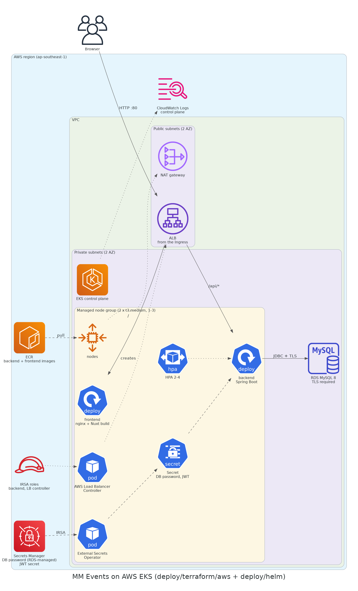

# MM Events on AWS

Terraform for running MM Events in your own AWS account: the Spring Boot API on ECS Fargate
behind an Application Load Balancer, MySQL 8 on RDS, secrets in Secrets Manager and the
static Nuxt site in S3 behind CloudFront.



| Piece | Service | Notes |
|---|---|---|
| Backend image | ECR `mm-events-backend` | Scan on push, keeps the last 10 images |
| API | ECS Fargate, 0.5 vCPU / 1 GiB, 1 task | `railway` Spring profile, health check `/actuator/health` |
| Load balancer | ALB, HTTP :80 | Security group only admits CloudFront (AWS-managed prefix list) |
| Database | RDS MySQL 8.0, `db.t4g.micro`, 20 GiB gp3 | Private subnets, encrypted, TLS required, 7-day backups |
| Secrets | Secrets Manager | DB password created and managed by RDS; JWT secret generated by Terraform |
| Frontend | S3 (private) + CloudFront (OAC) | One CloudFront domain serves the site and forwards `/api/*` to the ALB |
| Logs | CloudWatch Logs `/ecs/mm-events-backend` | 14 days |

Design choices:

- **One origin for site and API.** CloudFront serves the site from S3 and sends `/api/*`,
  `/actuator/health`, `/swagger-ui*` and `/v3/api-docs*` to the ALB. The browser only sees
  `https://<id>.cloudfront.net`, so there is HTTPS without a custom domain or certificate.
  A CloudFront Function rewrites client-side routes (paths without a file extension) to
  `/index.html`, which leaves API 403/404 responses untouched.
- **No NAT gateway.** The tasks run in public subnets with public IPs (about USD 35 a month
  saved). Their security group accepts port 8080 from the ALB only; RDS sits in private
  subnets and accepts 3306 from the tasks only.
- **No secrets in Terraform state.** RDS generates and stores the master password
  (`manage_master_user_password`). The JWT secret comes from an ephemeral `random_password`
  and is written with the write-only `secret_string_wo` argument. ECS injects both into the
  container at start.

## Prerequisites

- An AWS account you own, and credentials for it (`aws configure` or `AWS_PROFILE`) with
  rights to create VPC, ECS, ECR, RDS, ELB, CloudFront, S3, IAM, Secrets Manager and
  CloudWatch resources.
- Terraform 1.11 or newer (or the `hashicorp/terraform` Docker image), AWS CLI v2, Docker,
  Node.js 20.

## Deploy

All commands start in `deploy/terraform/aws`.

```bash
cp terraform.tfvars.example terraform.tfvars   # optional: every variable has a default
terraform init
```

**1. Create the registry first**, so that the ECS service has an image to start:

```bash
terraform apply -target=aws_ecr_repository.backend
```

**2. Build and push the backend image** (`linux/amd64`, also on Apple Silicon):

```bash
REPO=$(aws ecr describe-repositories --repository-names mm-events-backend --query 'repositories[0].repositoryUri' --output text)
aws ecr get-login-password | docker login --username AWS --password-stdin "${REPO%%/*}"
docker build --platform linux/amd64 -t "$REPO:latest" ../../../main_backend
docker push "$REPO:latest"
```

**3. Create everything else** (RDS takes about 10 minutes, CloudFront a few more):

```bash
terraform plan -out tfplan
terraform apply tfplan
curl "$(terraform output -raw health_url)"     # {"status":"UP"} once the task is healthy
```

**4. Build and upload the frontend:**

```bash
API=$(terraform output -raw api_base_url)
BUCKET=$(terraform output -raw site_bucket)
DIST=$(terraform output -raw cloudfront_distribution_id)

cd ../../../main_frontend/concert1
npm ci --legacy-peer-deps
NUXT_PUBLIC_BACKEND_BASE_URL="$API" npx nuxt generate
aws s3 sync .output/public "s3://$BUCKET" --delete
aws cloudfront create-invalidation --distribution-id "$DIST" --paths '/*'
```

Open `terraform output -raw frontend_url`. Flyway creates the schema on the first start;
register an account to fill the database.

## Day-to-day

- **New backend version:** push a new tag and set `image_tag`, then `terraform apply`. If
  you push over `latest`, run
  `aws ecs update-service --cluster mm-events --service backend --force-new-deployment`.
- **Logs:** `aws logs tail /ecs/mm-events-backend --follow`
- **Rotate the JWT secret:** bump `secret_version`, apply, then force a new deployment.
  Existing logins become invalid.

## Rough monthly cost

On-demand prices in `ap-southeast-1`, one task running all month, little traffic. Check the
[AWS Pricing Calculator](https://calculator.aws/) before you deploy.

| Item | USD / month |
|---|---|
| Fargate 0.5 vCPU + 1 GiB, 24/7 | ~23 |
| Application Load Balancer | ~20 |
| RDS `db.t4g.micro` + 20 GiB gp3 | ~22 |
| Public IPv4 addresses (ALB + task) | ~11 |
| Secrets Manager, CloudWatch, S3, CloudFront, ECR | ~3 |
| **Total** | **~80** |

Stopping the API (`backend_desired_count = 0`) saves the Fargate share; the ALB and RDS
keep charging until you destroy them.

## Destroy

```bash
terraform destroy
```

This deletes the database **without a final snapshot** (the default `deletion_protection
= false`) and the JWT secret without a recovery window. Set `deletion_protection = true`
before you keep real data. Empty the bucket first if `destroy` reports it is not empty.

## Limits

- CloudFront talks to the ALB over plain HTTP. With your own domain, add an ACM
  certificate, an HTTPS listener on the ALB and switch the origin to `https-only`.
- Photo uploads (`/api/upload`) need an S3 bucket and task-role permissions that are not
  part of this setup, as in the Railway demo.
- The login rate limit is kept in memory per task, so with more than one task each one
  counts separately.
