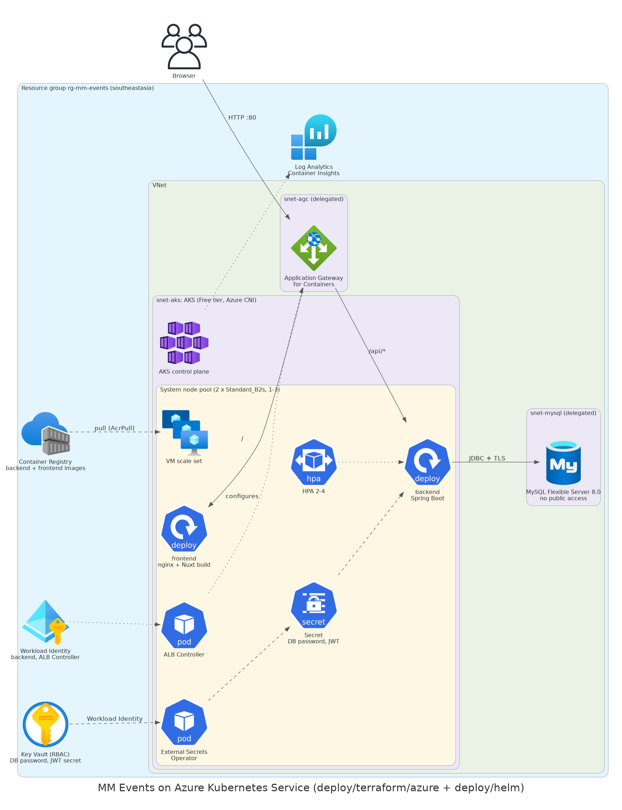

# MM Events on Azure (AKS)

Terraform for the Azure side and the shared Helm chart
[`deploy/helm/mm-events`](../../helm/mm-events) for the app: the Spring Boot API and the
nginx-served Nuxt frontend run on AKS behind Application Gateway for Containers, MySQL 8
runs on Azure Database for MySQL Flexible Server inside the VNet, and the secrets live in
Key Vault and reach the pods through the External Secrets Operator with Workload Identity.



| Piece | Service | Notes |
|---|---|---|
| Network | VNet: `snet-aks` /22, `snet-mysql` /24, `snet-agc` /24 | MySQL and AGC subnets delegated to their services |
| Kubernetes | AKS, Free tier, Azure CNI + Azure network policy | OIDC issuer and Workload Identity on; automatic patch upgrades |
| Nodes | System node pool, 2 x `Standard_B2s` (1-3) | Container Insights to Log Analytics |
| Images | Azure Container Registry (Basic) | Admin user off; the kubelet identity has `AcrPull` |
| Ingress | Application Gateway for Containers (bring-your-own) | ALB Controller with its own federated identity; HealthCheckPolicy on `/actuator/health` and `/health` |
| Database | MySQL Flexible Server 8.0, `B_Standard_B1ms`, 20 GB | No public endpoint, private DNS zone, TLS required, 7-day backups |
| Secrets | Key Vault (RBAC mode) | DB password and JWT secret, both generated by Terraform |
| Secret delivery | External Secrets Operator, `SecretStore` with Workload Identity | The backend's federated identity has `Key Vault Secrets User` on the vault |

**Frontend on the ingress, not a Storage static website.** The static Nuxt build is served
by an nginx pod behind the same gateway as the API: one origin, so no CORS and no mixed
content without a domain or certificate, the same chart works on all three clouds, and the
image is the repository's existing `main_frontend/concert1/Dockerfile`. Terraform creates
the gateway's frontend, so the site's URL is known before anything is installed.

**No secrets in Terraform state.** Both values come from ephemeral `random_password`
resources and are written through write-only arguments (`value_wo`,
`administrator_password_wo`). The `helm_values` output contains only names, IDs and
hostnames.

## Prerequisites

- An Azure subscription you own and `az login` as a user with **Owner** (or Contributor +
  User Access Administrator): Terraform creates role assignments.
- Terraform 1.11+, the Azure CLI, `kubectl`, Helm 3, Docker.
- Register the resource providers once if `apply` asks for them, e.g.
  `az provider register --namespace Microsoft.ServiceNetworking` (also `Microsoft.ContainerService`,
  `Microsoft.DBforMySQL`, `Microsoft.KeyVault`).

## Deploy

Commands start in `deploy/terraform/azure`.

```bash
ROOT=$(git rev-parse --show-toplevel)
CHART=$ROOT/deploy/helm/mm-events
TAG=$(git rev-parse --short HEAD)
```

**1. Infrastructure** (about 15-20 minutes):

```bash
cp terraform.tfvars.example terraform.tfvars   # set subscription_id (and api_server_authorized_ip_ranges)
terraform init
terraform plan -out tfplan
terraform apply tfplan
```

**2. kubeconfig:**

```bash
$(terraform output -raw kubeconfig_command)
kubectl get nodes
```

**3. Cluster add-ons:** the ALB Controller for Application Gateway for Containers and the
External Secrets Operator. Use the ALB Controller chart version listed in the
[Application Gateway for Containers quickstart](https://learn.microsoft.com/azure/application-gateway/for-containers/quickstart-deploy-application-gateway-for-containers-alb-controller).

```bash
ALB_CHART_VERSION=<version from the quickstart>
helm upgrade --install alb-controller oci://mcr.microsoft.com/application-lb/charts/alb-controller \
  --namespace azure-alb-system --create-namespace --version "$ALB_CHART_VERSION" \
  --set albController.namespace=azure-alb-system \
  --set albController.podIdentity.clientID="$(terraform output -raw alb_controller_client_id)" \
  --wait

helm repo add external-secrets https://charts.external-secrets.io
helm repo update
helm upgrade --install external-secrets external-secrets/external-secrets \
  --namespace external-secrets --create-namespace --wait
```

**4. Images.** The gateway's frontend URL already exists, so the frontend can be built
right away:

```bash
ACR=$(terraform output -raw acr_login_server)
SITE=$(terraform output -raw site_url)
az acr login --name "$(terraform output -raw acr_name)"

docker build --platform linux/amd64 -t "$ACR/backend:$TAG" "$ROOT/main_backend"
docker build --platform linux/amd64 --build-arg NUXT_PUBLIC_BACKEND_BASE_URL="$SITE" \
  -t "$ACR/frontend:$TAG" "$ROOT/main_frontend/concert1"
docker push "$ACR/backend:$TAG"
docker push "$ACR/frontend:$TAG"
```

**5. Install the chart:**

```bash
terraform output -raw helm_values > mm-events-values.yaml   # git-ignored; names and IDs only

helm upgrade --install mm-events "$CHART" \
  --namespace mm-events --create-namespace \
  -f "$CHART/values-azure.yaml" -f mm-events-values.yaml \
  --set backend.image.tag="$TAG" --set frontend.image.tag="$TAG"

kubectl -n mm-events get externalsecret,pods,ingress
curl "$SITE/actuator/health"     # {"status":"UP"}
```

Open `$SITE`. Flyway creates the schema on the backend's first start.

**HTTPS** needs a domain and a certificate in a Kubernetes TLS secret (for example from
cert-manager): set `ingress.host` and `ingress.tls`, point a CNAME at the gateway's
frontend FQDN, and rebuild the frontend with the `https://` URL.

## Day-to-day

- **New version:** build and push both images with a new tag, then `helm upgrade` with that
  tag. The rolling update keeps at least one backend pod serving (PDB `minAvailable: 1`).
- **Logs:** `kubectl -n mm-events logs deploy/mm-events-backend -f`, or Container Insights
  in the Log Analytics workspace.
- **Rotate the secrets:** bump `secret_version`, `terraform apply` (this also changes the
  MySQL administrator password), then
  `kubectl -n mm-events annotate externalsecret mm-events-backend force-sync=$(date +%s) --overwrite`
  and `kubectl -n mm-events rollout restart deploy/mm-events-backend`.

## Rough monthly cost

List prices in Southeast Asia, two nodes all month, little traffic. Check the
[Azure Pricing Calculator](https://azure.microsoft.com/pricing/calculator/) before you
deploy.

| Item | USD / month |
|---|---|
| AKS control plane, Free tier | 0 |
| 2 x `Standard_B2s` nodes + OS disks | ~80 |
| Application Gateway for Containers (gateway + frontend + association hours, minimum capacity) | ~110 |
| MySQL Flexible Server `B_Standard_B1ms` + 20 GB | ~18 |
| Container Registry Basic | ~5 |
| Log Analytics, Key Vault, private DNS zone, outbound public IP | ~10 |
| **Total** | **~225** |

Application Gateway for Containers is about half the bill, mostly the subnet association
(about USD 0.12/hour in the
[pricing example](https://learn.microsoft.com/azure/application-gateway/for-containers/understanding-pricing)).
For a cheaper demo, install a community ingress controller (for example Traefik) instead,
set `ingress.className` to its class, turn off `azureAlbHealthCheckPolicy`, and drop
`agc.tf`.

## Destroy

```bash
helm uninstall mm-events --namespace mm-events
helm uninstall alb-controller --namespace azure-alb-system
helm uninstall external-secrets --namespace external-secrets
terraform destroy
```

This deletes the resource group with the cluster, the database and its backups. The
provider purges the soft-deleted Key Vault, so the same names can be used again.

## Limits

- Photo uploads (`/api/upload`) use AWS S3 in the code and are not available here, as in the
  Railway demo.
- The login rate limit is kept in memory per pod.
- The Kubernetes API is open to every network unless `api_server_authorized_ip_ranges` is set.
