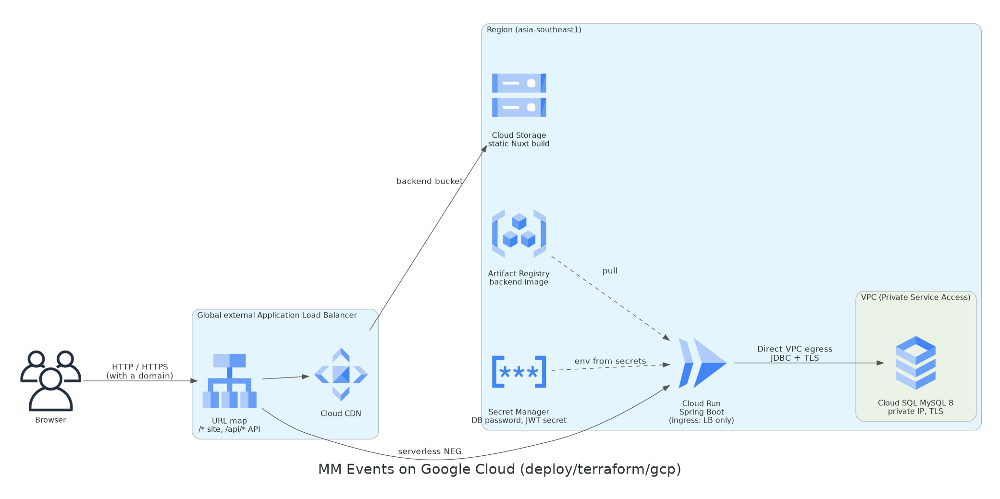

# MM Events on Google Cloud (GKE)

Terraform for the Google Cloud side and the shared Helm chart
[`deploy/helm/mm-events`](../../helm/mm-events) for the app: the Spring Boot API and the
nginx-served Nuxt frontend run on GKE behind the global external Application Load Balancer
created by GKE Ingress, MySQL 8 runs on Cloud SQL with a private IP, and the secrets live in
Secret Manager and reach the pods through the External Secrets Operator with Workload
Identity.



| Piece | Service | Notes |
|---|---|---|
| Network | VPC-native subnet (pods and Services on secondary ranges) | Private Google Access, Cloud NAT for the private nodes |
| Kubernetes | GKE Standard, zonal, `REGULAR` release channel | Private nodes, public control-plane endpoint limited by `master_authorized_networks` |
| Nodes | One node pool, 2 x `e2-medium` (1-3), COS, Shielded VMs | Own least-privilege node service account; GKE metadata server for Workload Identity |
| Images | Artifact Registry `mm-events` (`backend`, `frontend`) | 10 newest versions kept |
| Ingress | GKE Ingress on a reserved global static IP | Container-native load balancing (NEGs); BackendConfig health checks on `/actuator/health` and `/health` |
| Database | Cloud SQL MySQL 8.0, `db-f1-micro`, 10 GB SSD | Private IP only (Private Service Access), TLS required, daily backups |
| Secrets | Secret Manager | DB password and JWT secret, both generated by Terraform |
| Secret delivery | External Secrets Operator, `SecretStore` with Workload Identity | The backend's Kubernetes service account maps to a Google service account that may read exactly the two secrets |

**Frontend on the ingress, not Cloud Storage + CDN.** The static Nuxt build is served by an
nginx pod behind the same load balancer as the API: one origin, so no CORS and no mixed
content without a domain or certificate, the same chart works on all three clouds, and the
image is the repository's existing `main_frontend/concert1/Dockerfile`. Because the Ingress
uses a static IP reserved by Terraform, the site's URL is known before anything is
installed. The trade-off is no CDN; Cloud CDN can be enabled per backend with a BackendConfig.

**No secrets in Terraform state.** Both values come from ephemeral `random_password`
resources and are written through write-only arguments (`secret_data_wo`, `password_wo`).
The `helm_values` output contains only names and addresses.

## Prerequisites

- A GCP project you own, with billing enabled, and `gcloud auth application-default login`
  as a user with Owner (or Editor + Project IAM Admin + Service Networking Admin) on it.
- Terraform 1.11+, the gcloud CLI with `gke-gcloud-auth-plugin`, `kubectl`, Helm 3, Docker.

## Deploy

Commands start in `deploy/terraform/gcp`.

```bash
ROOT=$(git rev-parse --show-toplevel)
CHART=$ROOT/deploy/helm/mm-events
TAG=$(git rev-parse --short HEAD)
```

**1. Infrastructure** (about 15-20 minutes; Cloud SQL and GKE are the slow parts):

```bash
cp terraform.tfvars.example terraform.tfvars   # set project_id (and master_authorized_networks)
terraform init
terraform plan -out tfplan
terraform apply tfplan
```

**2. kubeconfig:**

```bash
$(terraform output -raw kubeconfig_command)
kubectl get nodes
```

**3. External Secrets Operator:**

```bash
helm repo add external-secrets https://charts.external-secrets.io
helm repo update
helm upgrade --install external-secrets external-secrets/external-secrets \
  --namespace external-secrets --create-namespace --wait
```

**4. Images.** The site's URL is the reserved IP, so the frontend can be built right away:

```bash
REPO=$(terraform output -raw image_repository)
SITE=$(terraform output -raw site_url)
gcloud auth configure-docker "${REPO%%/*}"

docker build --platform linux/amd64 -t "$REPO/backend:$TAG" "$ROOT/main_backend"
docker build --platform linux/amd64 --build-arg NUXT_PUBLIC_BACKEND_BASE_URL="$SITE" \
  -t "$REPO/frontend:$TAG" "$ROOT/main_frontend/concert1"
docker push "$REPO/backend:$TAG"
docker push "$REPO/frontend:$TAG"
```

**5. Install the chart:**

```bash
terraform output -raw helm_values > mm-events-values.yaml   # git-ignored; names and addresses only

helm upgrade --install mm-events "$CHART" \
  --namespace mm-events --create-namespace \
  -f "$CHART/values-gcp.yaml" -f mm-events-values.yaml \
  --set backend.image.tag="$TAG" --set frontend.image.tag="$TAG"

kubectl -n mm-events get externalsecret,pods,ingress
curl "$SITE/actuator/health"     # the load balancer takes 5-10 minutes to start routing
```

Open `$SITE`. Flyway creates the schema on the backend's first start.

**HTTPS** needs a domain: point its `A` record at `terraform output -raw ingress_ip`,
create a `ManagedCertificate` (networking.gke.io/v1) for it, add the annotation
`networking.gke.io/managed-certificates: <its name>` to the Ingress, set `ingress.host`, and
rebuild the frontend with the `https://` URL.

## Day-to-day

- **New version:** build and push both images with a new tag, then `helm upgrade` with that
  tag. The rolling update keeps at least one backend pod serving (PDB `minAvailable: 1`).
- **Logs:** `kubectl -n mm-events logs deploy/mm-events-backend -f`, or Cloud Logging
  (workload logs are collected).
- **Rotate the secrets:** bump `secret_version`, `terraform apply` (this also changes the
  Cloud SQL user's password), then
  `kubectl -n mm-events annotate externalsecret mm-events-backend force-sync=$(date +%s) --overwrite`
  and `kubectl -n mm-events rollout restart deploy/mm-events-backend`.

## Rough monthly cost

List prices in `asia-southeast1`, two nodes all month, little traffic. Check the
[Google Cloud Pricing Calculator](https://cloud.google.com/products/calculator) before you
deploy.

| Item | USD / month |
|---|---|
| GKE cluster management fee (USD 0.10/hour) | ~73, covered by the GKE free tier credit for one zonal cluster per billing account |
| 2 x `e2-medium` nodes + 2 x 30 GB balanced disks | ~70 |
| Load balancer forwarding rule | ~18 |
| Cloud SQL `db-f1-micro` + 10 GB SSD + backups | ~12 |
| Cloud NAT, static IP, Artifact Registry, Secret Manager | ~3 |
| **Total** | **~100** (about 175 without the free tier credit) |

## Destroy

Delete what Kubernetes created first, so GKE removes the load balancer and NEGs:

```bash
helm uninstall mm-events --namespace mm-events
kubectl -n mm-events get ingress                  # wait until it is gone
helm uninstall external-secrets --namespace external-secrets
terraform destroy
```

This deletes the cluster, the database and its backups (the default `deletion_protection =
false`); set `deletion_protection = true` before you keep real data. The enabled APIs stay
enabled, and the VPC peering for Private Service Access is abandoned rather than deleted
(Google removes it once Cloud SQL is gone); if `destroy` reports the network still in use,
wait a few minutes and run it again.

## Limits

- Photo uploads (`/api/upload`) use AWS S3 in the code and are not available here, as in the
  free demo.
- The login rate limit is kept in memory per pod.
- `master_authorized_networks` defaults to everywhere; narrow it to your IP.
